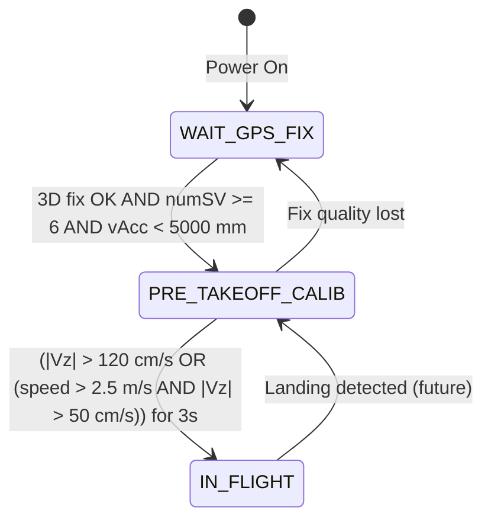

# Software Architecture & Mathematical Reference — VarioGPS-BLE

This document details the layered embedded architecture, execution model, hardware interfaces, register maps, and fixed-point integer mathematics implemented in the **VarioGPS-BLE** firmware.

---

## 1. Architectural Layers & Boundaries

The firmware follows strict hierarchical layer isolation without dynamic memory allocation (`malloc`, `new`) or C++ exceptions. Lower layers never depend on or reference upper layers.

```mermaid
graph TD
    subgraph LayerApp ["Application Layer (app/)"]
        APP["vario_app.cpp / .hpp<br/>(Tick Orchestration: 50 Hz, 1 Hz, 30s loops & WFE sleep)"]
    end

    subgraph LayerMiddleware ["Middleware Layer (middleware/)"]
        ENG["vario_engine.cpp / .hpp<br/>(dP/dt calculation, baro scaling, IIR alpha filter)"]
        FMT["lk8ex1_formatter.cpp / .hpp<br/>(NMEA sentence building & XOR checksum)"]
        GNSS_P["gnss_processor.cpp / .hpp<br/>(3-State Flight FSM, QNH LUT calibration, trace queue)"]
        BUZ["buzzer.cpp / .hpp<br/>(Climb/sink audio generator, zero DC bias)"]
        BATT["battery_monitor.cpp / .hpp<br/>(Piecewise linear LiPo SoC estimation)"]
        BLE_S["ble_service.cpp / .hpp<br/>(Custom GATT service: 6 characteristics)"]
    end

    subgraph LayerDrivers ["Driver Layer (drivers/)"]
        BMP["bmp390.cpp / .hpp / bmp390_defs.hpp<br/>(Sensor init, calibration unpacking, 64-bit integer compensation)"]
        GPS["sam_m10q.cpp / .hpp<br/>(UBX-CFG-VALSET setup, UBX-NAV-PVT parser, Fletcher-8)"]
    end

    subgraph LayerHAL ["Hardware Abstraction Layer (hal/)"]
        I2C["i2c_hal.cpp / .hpp<br/>(Zephyr I2C / TWIM0 abstraction)"]
        SBUS["sensor_bus_hal.cpp / .hpp<br/>(Unified sensor facade for BMP390 at 0x76)"]
        UART["uart_hal.cpp / .hpp<br/>(Zephyr Async UART / UARTE1 with EasyDMA double-buffer)"]
        PWM["pwm_hal.cpp / .hpp<br/>(Differential PWM on P0.02 & P0.03, zero DC bias)"]
        ADC["adc_hal.cpp / .hpp<br/>(Zephyr SAADC AIN3 high-impedance battery reading)"]
        BLE_H["ble_hal.cpp / .hpp<br/>(Zephyr BLE stack, advertising & link callbacks)"]
    end

    subgraph LayerCommon ["Common Foundations (common/)"]
        CFG["config.hpp (Compile-time constants)"]
        ERR["error_codes.hpp (enum class Error : uint8_t)"]
        TYP["types.hpp (Fixed-width integer data structures)"]
    end

    APP --> ENG
    APP --> FMT
    APP --> GNSS_P
    APP --> BUZ
    APP --> BATT
    APP --> BLE_S
    APP --> BMP
    APP --> GPS
    APP --> I2C
    APP --> SBUS
    APP --> UART
    APP --> PWM
    APP --> ADC
    APP --> BLE_H

    ENG --> CFG
    ENG --> TYP
    ENG --> ERR

    FMT --> CFG
    FMT --> TYP
    FMT --> ERR

    GNSS_P --> CFG
    GNSS_P --> TYP
    GNSS_P --> ERR

    BUZ --> PWM
    BUZ --> CFG
    BUZ --> ERR

    BATT --> ADC
    BATT --> CFG
    BATT --> ERR

    BLE_S --> CFG
    BLE_S --> TYP
    BLE_S --> ERR

    BMP --> SBUS
    BMP --> CFG
    BMP --> TYP
    BMP --> ERR

    GPS --> UART
    GPS --> CFG
    GPS --> TYP
    GPS --> ERR

    SBUS --> I2C
    I2C --> ERR
    UART --> ERR
    PWM --> ERR
    ADC --> ERR
    BLE_H --> ERR

    classDef app fill:#2d1b4e,stroke:#6e4e8a,stroke-width:2px,color:#d8b4f8;
    classDef mid fill:#1b2838,stroke:#2a475e,stroke-width:2px,color:#66c0f4;
    classDef drv fill:#1e3d2f,stroke:#2b6e4e,stroke-width:2px,color:#8ae9b3;
    classDef hal fill:#3d2e1b,stroke:#8a682b,stroke-width:2px,color:#f8d8b4;
    classDef com fill:#2a2a2a,stroke:#555555,stroke-width:2px,color:#e0e0e0;

    class LayerApp,APP app;
    class LayerMiddleware,ENG,FMT,GNSS_P,BUZ,BATT,BLE_S mid;
    class LayerDrivers,BMP,GPS drv;
    class LayerHAL,I2C,SBUS,UART,PWM,ADC,BLE_H hal;
    class LayerCommon,CFG,ERR,TYP com;
```



---

## 2. Execution Timing & Power Management

The firmware executes deterministically using a single cooperative main thread synchronized to a periodic 50 Hz timer, paired with hardware EasyDMA interrupts:

- **50 Hz Task (every 20 ms):** Polls BMP390, runs 64-bit integer compensation, executes the discrete-time IIR filter, updates the buzzer tone state, and pushes BLE binary vario and LK8EX1 notifications.
- **1 Hz Task (every 1000 ms):** Dispatches the latest validated GNSS fix to the flight state machine, evaluates QNH calibration, updates device status flags, and transmits GPS notifications.
- **30s Task (every 30000 ms):** Reads battery voltage via SAADC (8 samples averaged), estimates SoC percentage, and dispatches battery telemetry.
- **Low-Power WFE Sleep:** The main thread sleeps in `k_timer_status_sync()`. During sleep, Zephyr puts the Cortex-M4F into System ON `WFE` sleep, keeping active CPU time under 0.55 ms per 20 ms cycle (> 97% sleep duty cycle).

---

## 3. Bosch BMP390 Register & Memory Map

The BMP390 is accessed over I2C at address `0x76` (SDO pin tied to GND):

| Address | Name | Type | Reset Value | Role in VarioGPS-BLE |
|:---:|:---:|:---:|:---:|:---|
| `0x00` | `CHIP_ID` | RO | `0x60` | Verified on boot (`0x60` for BMP390, `0x50` for BMP388) |
| `0x02` | `ERR_REG` | RO | `0x00` | Sensor error register |
| `0x03` | `STATUS` | RO | `0x00` | Data ready indicators |
| `0x04`–`0x09` | `DATA_0`..`DATA_5` | RO | `0x00` | 24-bit Pressure XLSB..MSB + 24-bit Temp XLSB..MSB |
| `0x1B` | `PWR_CTRL` | RW | `0x00` | Normal mode (`0x33`: `press_en=1`, `temp_en=1`, mode=normal) |
| `0x1C` | `OSR` | RW | `0x00` | Oversampling (`0x03`: Pressure x8, Temp x1) |
| `0x1D` | `ODR` | RW | `0x00` | Output Data Rate (`0x02`: 50 Hz) |
| `0x1F` | `CONFIG` | RW | `0x00` | On-chip IIR coefficient (`0x04`: coeff 3) |
| `0x31` | `NVM_PAR` | RO | — | Start of 21-byte trimming parameters block |
| `0x7E` | `CMD` | WO | `0x00` | Soft reset command (`0xB6`) |

---

## 4. u-blox SAM-M10Q GNSS Driver (UBX-NAV-PVT)

Communication uses the **UBX binary protocol** exclusively over UART with **EasyDMA double buffering** (128 bytes ping-pong) and a 5 ms inactivity timeout:

### 4.1 Boot Handshake Sequence
1. Open UART at default **9600 bps**.
2. Send `UBX-CFG-VALSET` command to reconfigure receiver UART1 to **115200 bps**.
3. Wait **100 ms**, reconfigure nRF52833 UART to **115200 bps**.
4. Send grouped `UBX-CFG-VALSET` into RAM layer (`0x01`):
   - Disable NMEA output (`CFG-UART1OUTPROT-NMEA = 0`)
   - Enable UBX output (`CFG-UART1OUTPROT-UBX = 1`)
   - Enable `UBX-NAV-PVT` at 1 Hz (`CFG-MSGOUT-UBX_NAV_PVT_UART1 = 1`, `CFG-RATE-MEAS = 1000`)
   - Dynamic model: Airborne < 1g (`CFG-NAVSPG-DYNMODEL = 6`)
   - Power optimization: GPS + Galileo active; GLONASS and BeiDou disabled; PSM cyclic tracking enabled (`CFG-PM-OPERATEMODE = 1`)

### 4.2 Fletcher-8 Checksum & Fix Quality Gates
Every incoming 100-byte frame is verified using Fletcher-8 over bytes 2 through 97.
Fixes are accepted only if they pass all 4 quality gates:
1. `fixType == 3` (3D fix)
2. `(flags & 0x01) != 0` (`gnssFixOK`)
3. `numSV >= 6` (at least 6 satellites used)
4. `vAcc < 5000` mm (vertical accuracy < 5.0 m)

---

## 5. Flight State Machine & Fixed-Point Mathematics



### 5.1 Safe Integer QNH Auto-Calibration (Lookup Table)
Under ISA, the relation between sea-level pressure $P_0$ (QNH), barometric pressure $P_{\text{baro}}$, and GPS altitude $h$ is:

$$P_0 = P_{\text{baro}} \cdot \left(1 - \frac{h}{44330}\right)^{-5.255}$$

Because `pow()` and floating-point math are strictly forbidden, this is evaluated using a **46-entry Flash lookup table** with fixed-point scale factor $2^{16} = 65536$:

```cpp
uint64_t prod = static_cast<uint64_t>(p_baro_pa) * interpolated_scale;
int32_t qnh_pa = static_cast<int32_t>(prod >> 16);
```
- Accuracy: Error $< 0.5\text{ Pa}$ from $-500\text{ m}$ to $+4000\text{ m}$ ($< 4\text{ cm}$ barometric altitude error).
- Rolling buffer: Averages 20 GPS altitude samples while stationary (`ground_speed < 1500 mm/s`).
- Frozen in flight: $P_0$ is locked immediately upon launch to prevent barometric step discontinuities.

### 5.2 Barometric Altitude Derivation
Computed via second-order Taylor expansion around calibrated $P_0$:

$$\Delta P = P_0 - P_{\text{baro}}$$
$$\text{alt\_cm} \approx \left(\frac{843400 \cdot \Delta P}{P_0}\right) \cdot \left(1 + 0.405 \cdot \frac{\Delta P}{P_0}\right)$$

Evaluated purely using 64-bit integer arithmetic without division by small variables.

### 5.3 Discrete-Time IIR Variometer Filter
Rate of change is converted to vertical velocity:
$$\text{raw\_vario} = \frac{\Delta P_{\text{cPa}} / \Delta t \times (-832)}{10000} \quad [\text{cm/s}]$$

Smoothed by single-pole discrete IIR filter ($\alpha = 26/256 \approx 0.1016$):
$$y[n] = \frac{26 \cdot x[n] + 230 \cdot y[n-1]}{256}$$
$$\tau = -\frac{0.020}{\ln(1 - 26/256)} \approx 187 \text{ ms}$$

---

## 6. Audio Buzzer Acoustics (Differential PWM)

Piezo audio is driven in differential phase opposition across `P0.02` (normal) and `P0.03` (inverted):
- **Climb:** Intermittent beeps between $+30\text{ cm/s}$ and $+500\text{ cm/s}$.
  - Frequency: $700\text{ Hz}$ to $2500\text{ Hz}$
  - Beep period: $600\text{ ms}$ down to $150\text{ ms}$ (50% on, 50% off)
- **Sink Alarm:** Continuous lower tone ($300\text{ Hz}$ down to $200\text{ Hz}$) below $-100\text{ cm/s}$.
- **Deadband:** Complete silence between $-100\text{ cm/s}$ and $+30\text{ cm/s}$.
- **Zero DC Bias:** In `pwm_stop()`, both pins are explicitly forced to `PWM_POLARITY_NORMAL` with pulse width 0, holding both terminals at 0V (system GND).

---

## 7. BLE GATT Custom Vario Service

Service UUID: `564E4152-494F-424C-4530-000000000001`

| Characteristic | UUID Suffix | Properties | Payload | Description |
|:---|:---:|:---:|:---:|:---|
| **Vario Data** | `...0002` | Notify | 14 bytes | `int32_t vz_cm_s`, `int32_t alt_baro_cm`, `uint32_t p_pa`, `int16_t temp_dc` |
| **GPS Data** | `...0003` | Notify | 28 bytes | `lat_e7`, `lon_e7`, `alt_msl_mm`, `speed_mm_s`, `v_acc_mm`, `sats`, `fix_type`, `state` |
| **LK8EX1 Stream** | `...0004` | Notify | Up to 64 bytes | Standard ASCII `$LK8EX1,...*XX\r\n` sentence |
| **Battery Level** | `...0005` | Read, Notify | 1 byte | SoC percentage (0–100 %) |
| **Device Status** | `...0006` | Read | 2 bytes | Bitmask: GPS fix valid, baro OK, buzzer active, flight state |
| **Settings** | `...0007` | Read, Write | 4 bytes | Protocol mask, vario notify rate (Hz), LK8EX1 rate (Hz) |
